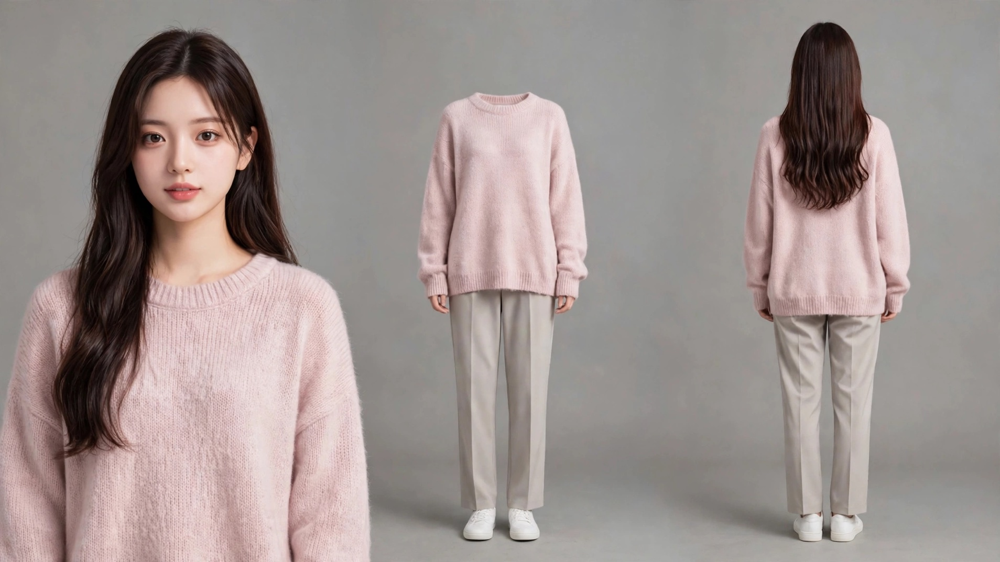
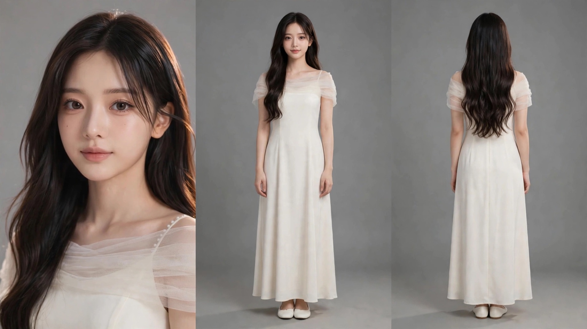

# yoyo-lira — Lira 式图片提示词技能（带头版 + 无头变体）

用精炼的自然文笔写图片生成提示词、按工种分流，并以 Lira 三格定妆板生产真人感角色资产的两个 Muse 技能。两个技能共享同一套方法与模板，只在人物定妆板的规格上分家：

| 技能 | 定妆板正面全身格 | 其余 |
| --- | --- | --- |
| `yoyo-lira` | 带头（默认版） | 基准版 |
| `yoyo-lira-nohead` | 无头：服装穿在隐形人身上（幽灵模特式） | 与带头版仅五处不同，其余逐字相同 |

## 共同方法

- **按工种分流**：先判定任务类型（角色生成 / 电影感场景与关键帧 / 道具产品图 / 外科式编辑 / 质感修复），再套对应模板，不用一个万能提示词打天下。
- **自然文笔而非关键词堆叠**：提示词写成流畅散文，预算约 1,500–2,000 字符，全部用正向表述——负面词堆叠只会把被禁止的东西招进画面。
- **技术化描述**：光线写方向、光比与衰减；材质写 finish；色彩按 60/30/10 比例点名真实色相；真人感作品用影棚照片 / 胶片质感锚定，防插画漂移。
- **外科式编辑**：编辑单一律 `目标一行 + CHANGE（只改一件事）+ PRESERVE EXACTLY（逐项锁死）`，一遍只改一处，移除物体必须带填补内容。
- **只出提示词**：两技能均为 prompt-only——只交付提示词 / 编辑单与验收清单，不主动生成图片，生成由使用者执行或另行下令。

## 定妆板规格（两版共通的骨架）

真人感三格定妆板，一面中灰影棚背景、同一人三格、服装逐格重申一致；参考照片只供身份（脸 / 发型 / 服装 / 风格），不供姿势，姿势全部由模板文本写死。版式（当前工作区口径）：近景格在左——端正证件式肖像（头正、平视、正面、静发、中性表情）为脸的唯一权威；全身正面居中供比例与服装；全身背面在右。不同状态（干净 / 破损 / 带伤）分开成板。

## yoyo-lira-nohead 的无头规格（v2，2026-11-08 定版）

无头规格来自 Higgsfield 长片《Hell Grind》的官方开源管线：宽景时视频模型会从全身小人那张模糊的脸取脸、或把全板多张脸平均成路人脸，所以正面全身格不给可读脸。**做法不是把人画成断头**——初版「无头、止于领口」的写法实测生成图被判「像被砍了一刀，一点不自然」。查官方公开档案的原始定妆板（角色 JAXX，资产 `9059f2e6-f126-4386-b99a-40dd5ceb925f`）后确认原版做法并经探针生成验证，v2 写法定为：

- 正面格是**幽灵模特式隐形穿着者**：衣服撑起自然肩形，领口按穿着时的形状空着合拢（兜帽竖起空着，或领圈闭合、内侧带柔和阴影），格内无头、无脖子、无头发；人物约占格高 3/4，肩膀上方留背景。
- 全板是**一整张宽幅照片**：三个人物在一面不间断的背景前、同一片地面上，格间无分隔线——旧写法「photographs side by side」的拼贴框架会稳定招来白边分隔线。
- 背面格保留头（背面无脸，头承载发型背面信息）；近景格仍是全板唯一可读脸。
- 自检带判失败条款：正面格出现脖颈截面或被画框裁头，判失败重出，不接受。

## 示例

**示例一 · yoyo-lira-nohead（无头版 v2 定版成品，2026-11-08）**



粉色针织毛衣角色的无头定妆板：左近景为全板唯一可读脸；中格正面全身是幽灵模特式空穿服装——圆领领口空着合拢、内侧阴影，无头、无脖子、无头发，人物约占格高 3/4；右格背面保留头与垂背长发。全图一面连续中灰背景、同一片地面，格间无分隔线。此图即 v2 规格定版后的正式成品（下装为原图不可见部分的补全：浅暖灰直筒裤＋白色平底鞋）。

**示例二 · yoyo-lira（带头版成品，2026-11-08）**



带头版标准三视图：左近景为端正证件式肖像（头正、平视、静发、中性表情，脸颊小痣保留）；中格全身正面带头，与右格背面等高对齐；三格服装一致（象牙白长裙＋肩部薄纱层，此服装为原图不可见部分的补全）。

## 文件结构

```
.
├── README.md
├── examples/
│   ├── example-nohead-sheet.jpg   # 示例一：无头版成品
│   └── example-headed-sheet.jpg   # 示例二：带头版成品
├── yoyo-lira/
│   ├── SKILL.md      # 带头版技能正文（基准）
│   └── skill.yaml    # 技能注册卡（name: yoyo-lira）
└── yoyo-lira-nohead/
    ├── SKILL.md      # 无头变体正文（与带头版仅五处不同）
    └── skill.yaml    # 技能注册卡（name: yoyo-lira-nohead）
```

## 安装与用法

把 `yoyo-lira/` 与 `yoyo-lira-nohead/` 两个文件夹放进你的 Muse 自定义技能目录（`~/workspace/custom-skills/`）即可被技能检索命中。调用时直接描述图片任务即可；人物资产可使用触发词 `@角色资产` 走定妆板模板。无头变体只在明确点名 `yoyo-lira-nohead` 时使用，默认走带头版。

## 治理

两技能文件头各有一条治理规则：严格按原文执行，任何改动须经技能所有者**三次确认**才落笔，未满三次文件保持原样。本仓库即按此流程维护——例如无头 v2 规格，就是「提案 → 探针生成验证 → 三次确认 → 落笔」的产物。

## 来源

- Lira 图片提示词体系：由使用者提供的 `LIRA_SKILL.md` 蒸馏，路由由品牌绑定改按工种绑定。
- 无头定妆板：Higgsfield《Hell Grind》官方开源简报（经 OSideMedia/higgsfield-ai-prompt-skill 仓库的 `HELL-GRIND.md`），及 Higgsfield 官方公开项目档案中的原始定妆板图片。
- 本仓库为个人技能存档，未附开源许可证；引用与改编请注明上述来源。
